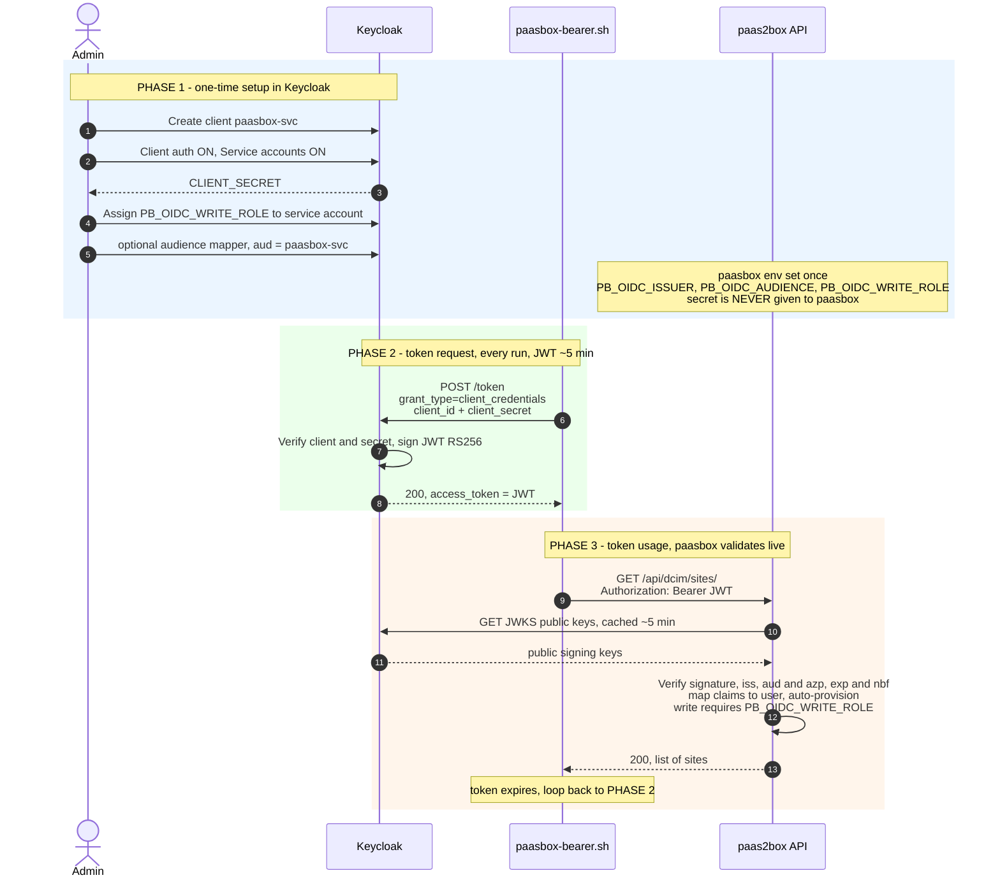

# Consuming the API when SSO is active (no frontend)

When paas2box runs with **SSO via OIDC/Keycloak** enabled (`PB_OIDC_ISSUER` set), you can
still call the REST API headlessly. `authenticate()`
([src/auth.ts](../src/auth.ts)) accepts **two** credential types, and the static-token
path runs *before* the OIDC check — so static API tokens keep working regardless of SSO:

| Credential | Header | Issued by | Lifetime | Best for |
|------------|--------|-----------|----------|----------|
| **Static API token** | `Authorization: Token <40-hex>` | paas2box (`POST /api/users/tokens/`) | long-lived (optional `expires`) | scripts / CI |
| **OIDC bearer JWT** | `Authorization: Bearer <jwt>` | Keycloak (token endpoint) | short (~5 min) | central credential/role lifecycle |

> The two are independent. A static token never touches Keycloak; a bearer JWT is verified
> live against the issuer's JWKS and mapped to an **auto-provisioned** local user.

---

## Option 1 — Static API token (recommended for machine-to-machine)

The token is issued **by paas2box** and stored in its own DB; Keycloak plays no part in
*using* it. Creating one requires an authenticated, write-enabled caller — so you bootstrap
it once with a bearer JWT (Option 2), then reuse the static key forever:

```bash
# one-time: bootstrap with a Keycloak token, mint a static key
curl -s -X POST "$PAASBOX_URL/api/users/tokens/" \
  -H "Authorization: Bearer $JWT" -H 'Content-Type: application/json' \
  -d '{"description":"ci-bot","write_enabled":true}'
# → {"id":7,"key":"a1b2…(40 hex, shown once)","write_enabled":true, …}

# from then on — no Keycloak in the loop:
curl -s "$PAASBOX_URL/api/dcim/sites/" -H "Authorization: Token a1b2…"
```

`GET /api/users/tokens/` lists your keys; `DELETE /api/users/tokens/{id}/` revokes one.
`expires` defaults to `null` (never). An admin can pre-provision a key so you skip the
bootstrap entirely.

---

## Option 2 — OIDC bearer JWT straight from Keycloak

Nothing is pre-registered in paas2box: you create a **client** in Keycloak once, fetch a
short-lived token at runtime, and send it as a bearer. paas2box verifies it against the
issuer's public keys.



Three facts this encodes (straight from [src/oidc.ts](../src/oidc.ts) / [src/auth.ts](../src/auth.ts)):

- The **secret** only ever travels Script ↔ Keycloak. paas2box never sees it.
- paas2box calls Keycloak only for **public JWKS keys** — never the token endpoint.
- Nothing is pre-registered in paas2box: it verifies any JWT the issuer signs, **auto-provisions**
  the user, and `PB_OIDC_WRITE_ROLE` decides read-only vs read-write.

### Curl

```bash
ISSUER="https://kc.example.com/realms/paasbox"   # = PB_OIDC_ISSUER
PAASBOX_URL="http://localhost:8000"
CLIENT_ID="paasbox-svc"; CLIENT_SECRET="••••••••"

# 1. fetch an access token (service account / client-credentials grant)
JWT=$(curl -s -X POST "$ISSUER/protocol/openid-connect/token" \
  -d grant_type=client_credentials \
  -d client_id="$CLIENT_ID" -d client_secret="$CLIENT_SECRET" | jq -r .access_token)

# 2. call paasbox with the bearer token
curl -s "$PAASBOX_URL/api/dcim/sites/" -H "Authorization: Bearer $JWT" | jq

# acting as a real user instead of a service account:
JWT=$(curl -s -X POST "$ISSUER/protocol/openid-connect/token" \
  -d grant_type=password -d client_id="$CLIENT_ID" \
  -d username=demo -d password=demo | jq -r .access_token)
```

A ready-made helper script wraps both grants:
[scripts/paasbox-bearer.sh](../scripts/paasbox-bearer.sh) —
`./scripts/paasbox-bearer.sh GET /api/dcim/sites/`.

### Keycloak client checklist (Phase 1)

- **Client authentication** ON (confidential) → a **Client secret** is generated (*Credentials* tab).
- **Service accounts roles** ON → enables the `client_credentials` grant.
- Assign the role named in `PB_OIDC_WRITE_ROLE` to the client's **service account** (else the
  caller is read-only when that env is set).
- If `PB_OIDC_AUDIENCE` is set, the token's `aud` must include it **or** its `azp` must equal it.
  Keycloak puts `azp = <client_id>`, so the simplest setup is `PB_OIDC_AUDIENCE = <client_id>`,
  or add an audience mapper.

### Troubleshooting

| Symptom | Cause / fix |
|---------|-------------|
| `403` on **writes**, `200` on reads | identity lacks `PB_OIDC_WRITE_ROLE` → assign it to the service account |
| `403`/auth fails on everything | audience mismatch → set `PB_OIDC_AUDIENCE` to the `client_id` (matches `azp`) or add an aud mapper; or the token expired |
| username is a UUID | a client-credentials token has no `preferred_username`; paas2box falls back to `sub`. Map `PB_OIDC_USERNAME_CLAIM` to a claim the token carries |
| inspect a token | `echo "$JWT" \| cut -d. -f2 \| base64 -d 2>/dev/null \| jq` — check `aud`, `azp`, `realm_access.roles`, `exp` |

## WebSocket change-feed (`/api/ws/`)

The live change-feed is authenticated too: when auth is required, an anonymous WebSocket
is rejected (closed with code `1008`). Browsers can't set request headers on a WebSocket,
so the credential goes in the query string — an OIDC bearer as `access_token`, else a
static token as `token`:

```bash
# OIDC bearer
wscat -c "wss://paasbox.example.com/api/ws/?access_token=$JWT"
# static API token
wscat -c "wss://paasbox.example.com/api/ws/?token=$KEY"
```

The bundled SPA does this automatically, re-reading the current token on every reconnect.

See also the **SSO via OIDC** entry in the [README](../README.md#features).
